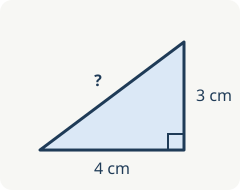

Author notes: import `moodle-check.xml` into a test question bank, open each question in preview
and compare with what each statement says it should show.

# THEME formulas | Formulas
COURSE: Moodle check, formulas

## Q inline-formula | level 3 | 30s
Inline formulas: what is $\frac{1}{2} + \frac{1}{3}$ when $a < b$ and $\left\{ x \mid x > 0 \right\}$ is a set?

- [x] $\frac{5}{6}$
  > Same denominator first: $\frac{3}{6} + \frac{2}{6} = \frac{5}{6}$.
- [ ] $\frac{2}{5}$
  > Numerators and denominators do not add up separately.
- [ ] $\frac{1}{6}$
  > That is the product, not the sum.

RULE: To add fractions, bring them to the same denominator: $\frac{a}{c} + \frac{b}{c} = \frac{a+b}{c}$.
REVIEW: Moodle check, fractions

## Q display-formula | level 3 | 30s
A display formula, centred on its own line:

$$\int_0^1 x^2 \, dx$$

A price is no formula: the book costs \$5, the bag \$10. What is the value of the integral?

- [x] $\frac{1}{3}$
- [ ] $\frac{1}{2}$
- [ ] $1$

RULE: $$\int_0^1 x^n \, dx = \frac{1}{n+1}$$

# THEME code | Code
COURSE: Moodle check, code

## Q python-code | level 3 | 40s
Coloured Python, line 2 highlighted:

```python {2}
def total(values):
    return sum(v * v for v in values)  # squares

print(total([1, 2, 3]))
```

What does it print?

- [x] `14`
  > 1 + 4 + 9 = 14.
- [ ] `6`
  > That is the sum without squaring.
- [ ] `36`
  > That squares the sum, not each value.

## Q csharp-code | level 3 | 40s
Coloured C#, with `<`, `>` and `&&` that must stay as written:

```cs
for (int i = 0; i < 3 && i > -1; i++)
    Console.WriteLine("i = " + i);
```

How many lines does it print?

- [x] 3
- [ ] 2
- [ ] 4

# THEME media | Media
COURSE: Moodle check, media

## Q picture | level 2 | 30s


A picture above. How long is the hypotenuse?

- [x] 5 cm
- [ ] 7 cm
- [ ] 12 cm

## Q sound | level 1 | 20s


A sound player above, one second long. What do you hear?

- [x] A steady tone
- [ ] A spoken word
- [ ] Nothing at all

## Q video | level 1 | 20s


A video player above, two seconds long. What does it show?

- [x] A colour test pattern
- [ ] A person talking
- [ ] A black screen

# THEME answers | Answers and text
COURSE: Moodle check, answers

## Q several-answers | level 2 | 30s
Several answers: two of these four are right, each worth half.

- [x] 2 is even
- [x] 3 is odd
- [ ] 5 is even
- [ ] 6 is odd

## Q true-false | level 1 | 15s
True or false: water boils at 100 °C at sea level.

- [x] True
- [ ] False
  > At sea level, water boils at 100 °C.

## Q text-styles | level 1 | 20s
Text styles: **bold**, *italic*, `inline code`, accents (café, élève, naïve) and the signs < > & as written.

- [x] All are shown as written
- [ ] Some show as code
- [ ] Some are missing
